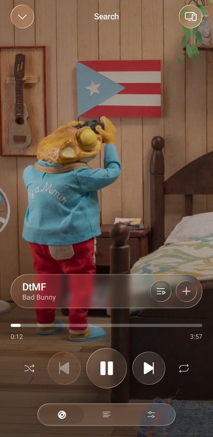
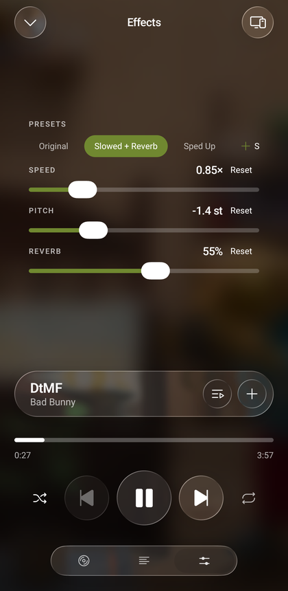
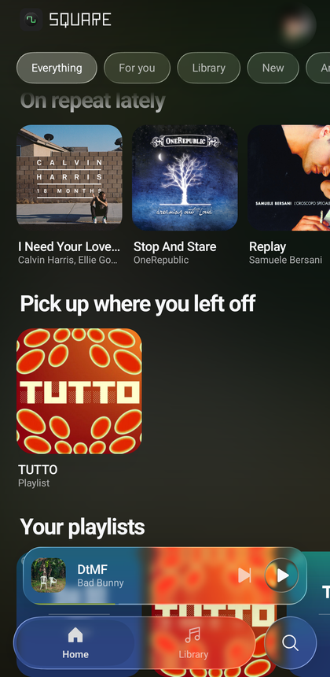

<p align="center">
  
</p>

<h1 align="center">Square</h1>

<p align="center">
  An unofficial Android music player for Spotify Premium, YouTube Music, and local audio files,
  built in Liquid Glass.
</p>

One app over three sources. Spotify plays through
[librespot](https://github.com/librespot-org/librespot), so the official app is
not needed and is not used: audio is streamed in-process by a native Rust core.
YouTube Music plays through its own endpoints, where search and playback need no
account at all. Local music scans audio already on the phone through Android MediaStore and plays it offline. Which source the music comes from is the first question a fresh install asks, and it can be changed later in the settings.

| Player | Effects | Home |
| --- | --- | --- |
|  |  |  |

## Why use this instead of the official apps

**It is one app for three sources.** The same player and audio effects work with
Spotify, YouTube Music, and files already on the phone. Spotify is your own account, with
its playlists, its Connect devices and its listening history, and it needs a
login and a little setup. YouTube Music is the whole catalogue, searchable and
playable the moment the app opens, with signing in optional and worth it only
for your own playlists.

**It is built in Liquid Glass.** Every control, the tab bar, the player, the
sheets and the menus, is drawn on one refracting material that bends the artwork
and the canvas video behind it. Nothing on Spotify for Android looks like this,
and it is the reason the app exists.

**It can bend the music.** Speed and pitch move independently, there is a real
reverb on the output, and the three save as presets, so "slowed + reverb" is a
single tap on any track in the catalogue rather than a file someone else made.

**It is fast.** A skip is sound in about a third of a second, because the engine
fetches the next track while the current one plays and the app never waits on it
to move. The playing list is cached rather than rebuilt, so scrolling stays at
the screen's own frame rate.

> **Read this before you install it.** The online backends talk to services on terms
> they do not offer: Square re-implements Spotify's protocol, which their Terms
> of Service forbid, and reads YouTube Music through the private endpoints its
> own web client uses. It cannot go on the Play Store, the Spotify side needs a
> Premium account, and using it is at your own risk. There is no warranty of any
> kind. See the licence.

## What it does

- **Plays from three sources.** Spotify, YouTube Music, or local audio files, chosen at first launch and changeable in settings. Local music is indexed by Android MediaStore after the audio permission is granted, and is playable offline.
- **Plays your library.** Playlists, albums, artists, liked songs, search. On
  Spotify through its own access point rather than the public Web API; on
  YouTube Music anonymously, with an optional Google sign-in that adds the
  account's own playlists and home shelves.
- **Is a Connect device** *(Spotify)*. Square appears in the device list of
  every other Spotify client, and playback can be handed to and taken from it.
- **Records what you listen to** *(Spotify)*. Listens are reported to the
  account, filed under the playlist or album they happened in, so Square can be
  used *instead* of the official client rather than beside it.
- **Lyrics, canvas, artwork.** Synced lyrics, from Spotify where it has them
  and from [LrcLib](https://lrclib.net) for the YouTube side; the looping
  Spotify canvas video on the player; and the covers of the generated playlists
  in the app's own language.
- **Watches the video** *(YouTube Music)*. One tap on the player swaps the audio
  stream for the real video, in place, without losing the queue or the position.
- **Audio effects.** Speed and pitch independently, plus reverb, with presets:
  the "slowed + reverb" edit, done properly, on any track.
- **Android Auto.** Playlists and recently played are browsable in the car, and
  voice search plays from the catalogue. Auto only lists apps it was installed
  beside, so a sideloaded build needs "Unknown sources" turned on in Android
  Auto's developer settings.
- **Eight languages.** English, Italian, Spanish, French, German, Portuguese, Hindi and Turkish, with a picker independent of the phone's language.

## Architecture

```
┌──────────────────────────────────────────────────────────────────────┐
│ Compose UI → MediaController → MediaSession → PlaybackService        │
├──────────────────────────┬───────────────────────┬───────────────────┤
│ SpotifyBackend           │ YouTubeBackend        │ LocalMusicBackend │
│ LibrespotPlayer          │ ExoPlayer             │ ExoPlayer         │
│ native Rust engine       │ YouTube stream resolver│ MediaStore URIs   │
├──────────────────────────┼───────────────────────┼───────────────────┤
│ Spotify access point/API │ NewPipe + InnerTube   │ Android MediaStore│
└──────────────────────────┴───────────────────────┴───────────────────┘
```

`MusicBackend` is the seam: every catalogue read and the `Player` itself come
from it, so no screen has to know which source is answering. A backend that
cannot do something, as YouTube Music and local files have no Spotify Connect
device list, returns the empty value rather than throwing.

On the YouTube side the split is by what needs an account, not by preference.
Search, trending and stream URLs are public and go through NewPipeExtractor,
which is why the app works before anyone signs in and for anyone who never does.
The library is the account's own, so it goes through the vendored
[`innertube/`](innertube/) module with the session cookie attached.

On the Spotify side the catalogue comes from the access point
(`native/src/catalog.rs`), not from `api.spotify.com`: the Web API meters
requests per application, and there is no streaming endpoint there at all. The
Web API is used only where the access point has nothing to offer: search, the
account's top tracks, the Connect device list and editing playlists. That is why
Square asks you to register an application of your own.

The player keeps no copy of the engine's state: `LibrespotPlayer` reports only
what the engine has confirmed by event. That is why the seek bar never runs
ahead of the audio.

## Building

Requirements:

- Android SDK platform 37, Build Tools 36.0.0, CMake 3.22.1, and **NDK 28.2.13676358**
- Rust ≥ 1.88 with the `aarch64-linux-android` target
- `cargo-ndk`

```bash
rustup target add aarch64-linux-android
cargo install cargo-ndk
sdkmanager --install "platforms;android-37" "build-tools;36.0.0" "ndk;28.2.13676358" "cmake;3.22.1"
```

Then:

```bash
./gradlew :app:assembleDebug
```

The `cargoBuild` task cross-compiles the core and copies the `.so` files into
`app/src/main/jniLibs`. To iterate faster, cut `nativeAbis` in
`app/build.gradle.kts` down to `arm64-v8a`.

### GitHub Actions

The workflow at `.github/workflows/android-build.yml` runs on pushes, pull
requests, or manual dispatch. It installs the Android SDK, NDK, CMake, Rust and
`cargo-ndk`, then builds debug and release APKs. Open the run under the
repository's **Actions** tab and download the `square-android-apks` artifact.
The release APK uses the repository owner's real signing key only when
`keystore.properties` and its private keystore are provided securely; otherwise
it falls back to the debug key and is for build/testing verification only, not
for public distribution or upgrading a differently signed installed app.

### Signing a release build

The release build is signed with a real key when `keystore.properties` exists
beside the project, and with the debug key otherwise. The file and the keystore
are both ignored by git and must stay that way.

```bash
keytool -genkey -v -keystore square-release.jks -keyalg RSA \
        -keysize 2048 -validity 10000 -alias square
```

```properties
# keystore.properties, never commit this
storeFile=square-release.jks
storePassword=…
keyAlias=square
keyPassword=…
```

## Notes for anyone reading the code

**`librespot-core` is patched.** A local copy under `native/vendor/`, wired in
with `[patch.crates-io]`. Four changes: the advertised OS is pinned to
`"linux"` so it agrees with the desktop client id, Mercury gained POST and
header fields so listening events can be posted, the session carries a language
so artwork comes back in it, and a non-premium account no longer exits the
process. All four are explained in
[native/vendor/README.md](native/vendor/README.md).

**OAuth uses the keymaster client id on a fixed port.** The redirect has to be
exactly `http://127.0.0.1:5588/login`, the only one registered for that id, and
the socket must be bound to the IPv4 loopback explicitly: on Android
`InetAddress.getLoopbackAddress()` answers `::1` and the browser then fails the
redirect with `ERR_CONNECTION_REFUSED`.

**`MediaSession.Callback` is not optional.** A session never hands a
controller's `MediaItem`s to the player directly; it asks the app to resolve
them first, and the default implementation rejects every item without a
playable URI. Ours carry only a `mediaId`, so without `onAddMediaItems` the call
vanishes silently.

**Do not rebuild the playlist in `getState()`.** It runs on every
`invalidateState`, which includes each position update: rebuilding dozens of
`MediaItemData` twice a second makes enough garbage to be heard as stuttering.
The list is cached and dropped only when the queue actually changes.

**Keep NewPipeExtractor current.** YouTube breaks extraction deliberately and
often, and a version a few months stale does not fail loudly: v0.24.6 still
searched fine while every stream answered "The page needs to be reloaded". If
YouTube playback stops working and search does not, bump that version first.

**`vergen` is pinned to 9.0.6.** `librespot-core` 0.8.0's build script does not
compile against 9.1.0, a semver-compatible bump that changed the `Add` trait.
The pin lives in `native/Cargo.lock`.

**Token refresh is serialised.** `TokenStore.validAccessToken()` takes a mutex
before refreshing. Spotify rotates refresh tokens, so without it two parallel
requests around expiry would each refresh and the loser would save a token that
is already dead. It is the bug behind the random logouts in most other clients.

## Third-party code

| Project | Licence | How it is used |
| --- | --- | --- |
| [librespot](https://github.com/librespot-org/librespot) | MIT | The Spotify engine. `librespot-core` is vendored with local patches. |
| [Metrolist](https://github.com/mostafaalagamy/Metrolist) | GPL-3.0 | Its InnerTube client, vendored as [`innertube/`](innertube/), because it is published nowhere else. Powers the signed-in YouTube Music library. |
| [NewPipeExtractor](https://github.com/TeamNewPipe/NewPipeExtractor) | GPL-3.0 | Anonymous YouTube Music search and stream URLs. |
| [LrcLib](https://lrclib.net) | n/a | Synced lyrics for the YouTube Music backend, over its open API. |
| [Bungee](https://github.com/kupix/bungee) | MPL-2.0 | Time stretching, fetched at build time. |
| [AndroidLiquidGlass](https://github.com/Kyant0/AndroidLiquidGlass) | Apache-2.0 | The glass material; the catalog components are copied with their notice. |
| [Phosphor Icons](https://phosphoricons.com) | MIT | Every icon in the app. |
| librespot-java | Apache-2.0 | The listening-event format, re-implemented from its `EventService` rather than copied. |

## Licence

GPL-3.0-or-later. See [LICENSE](LICENSE).
